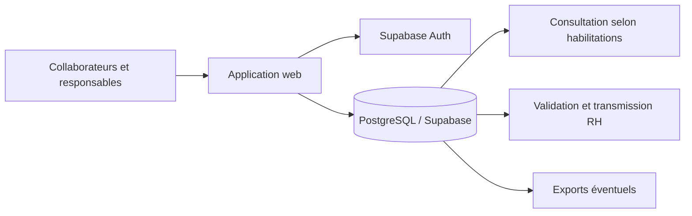

# Analyse RGPD — Astreintes et Travaux Supplémentaires

> **Statut :** analyse préliminaire du modèle de données, à faire valider par le DPO et le RSSI.  
> **Date :** 16 octobre 2026  
> **Périmètre :** schéma PostgreSQL/Supabase, branche `main` du dépôt `ellandar31/astreintes`.  
> **Sources :** [Description du schéma](https://github.com/ellandar31/astreintes/blob/main/docs/database-schema.md) · [DDL SQL](https://github.com/ellandar31/astreintes/blob/main/schema.sql).  
> **Limite :** examen statique du modèle et des règles SQL ; ne constitue ni un audit de déploiement, ni une attestation de conformité.

## 1. Objet et finalités du traitement

L'application permet de planifier et tracer les astreintes régulières, astreintes exceptionnelles, interventions et travaux supplémentaires, d'identifier les agents et responsables concernés, de recueillir des visas et de préparer la transmission aux ressources humaines.

| Finalité envisagée | Données nécessaires | Justification à documenter |
| --- | --- | --- |
| Gestion des utilisateurs et habilitations | Identité professionnelle, courriel, rôle, équipe, identifiant Auth | Contrôle d'accès et administration |
| Planification des astreintes | Agent, équipe, début et fin de période | Organisation du service |
| Traçabilité des interventions et travaux | Agent, horaires prévus/réels, libellés et commentaires | Suivi opérationnel et justification des interventions |
| Validation et transmission RH | Signataire, date, visa, statut d'envoi | Contrôle et validation des éléments transmis |
| Calcul ou préparation des compensations | Durées, nature des périodes, règles de coefficient | Application des règles de compensation en vigueur |

**Bases légales : à déterminer par le responsable de traitement avec le DPO** selon le statut des agents et le cadre applicable (obligation légale, exécution d'un contrat ou mission d'intérêt public selon les cas). Ne pas retenir par défaut le consentement des salariés pour un traitement RH nécessaire à la gestion du travail.

## 2. Personnes concernées

- Agents participant aux astreintes, interventions ou travaux supplémentaires.
- Initiateurs, responsables d'opération, directeurs, RH et administrateurs.
- Signataires des visas.

Les données concernent des personnes physiques identifiables directement ou par rapprochement avec les identifiants internes. Les identifiants numériques et UUID sont donc également des données personnelles lorsqu'ils sont rattachables à un collaborateur.

## 3. Inventaire des données par table

| Table(s) | Champs ou données personnelles significatifs | Qualification et vigilance |
| --- | --- | --- |
| `app_users` | `auth_user_id`, `email`, `display_name`, `role`, `signature_mode`, `signature_name`, `signature_image`, `signature_drawing`, `last_login_at`, horodatages | Identité, habilitations, données de connexion et représentation de signature ; **sensibilité élevée pour les signatures** |
| `teams`, `team_members` | Nom d'équipe, associations `user_id` / `team_id` | Appartenance organisationnelle ; donnée indirectement personnelle |
| `regular_on_call_periods` | `user_id`, `team_id`, `starts_at`, `ends_at`, `sent_to_rh_at` | Planning nominatif et historique RH |
| `regular_interventions` | `user_id`, `starts_at`, `ends_at`, `comment` | Horaires réels et zone de texte libre ; risque de données excessives |
| `exceptional_on_calls`, `exceptional_works` | Initiateur, responsable, nom du responsable, `title`, horaires prévus et réels, envoi RH | Identification des responsables et suivi des opérations ; texte libre |
| `exceptional_on_call_participants`, `exceptional_work_participants` | `user_id`, `participant_kind` (`planned`/`actual`), horaires | Présence prévue ou réelle ; chronologie d'activité individuelle |
| `exceptional_on_call_interventions` | `user_id`, horaires, `label`, `comment` | Activité individualisée et texte libre |
| `visas`, `exceptional_on_call_visas`, `exceptional_work_visas` | Signataire, nom figé, date de signature, `signature_mode`, `signature_value` | Preuve de validation, données de signature répliquées |
| `rh_on_call_compensation_rules`, `rh_period_compensation_rules` | Codes, coefficients et règles | Paramètres non personnels isolément ; deviennent des éléments RH lorsqu'appliqués à des agents |
| `schedule_rules`, `public_holidays` | Règles horaires, jours fériés | Référentiels sans données personnelles directes dans le schéma |

**Données de l'authentification Supabase :** la table externe `auth.users` est référencée par `app_users.auth_user_id`. Son contenu, les journaux Auth, les éventuels jetons et la configuration du fournisseur d'identité doivent faire l'objet d'un inventaire complémentaire.

### Catégories particulières et risques d'inférence

Le schéma n'impose pas la collecte de données de santé, d'opinions, de données syndicales ou de données biométriques. Toutefois, les champs libres (`comment`, `label`, `title`) pourraient en contenir accidentellement. Une signature dessinée ou une image de signature **n'est pas automatiquement une donnée biométrique au sens de l'article 9** : cela dépend notamment de l'existence d'un traitement technique spécifique permettant l'identification unique. Elle reste une donnée personnelle nécessitant une protection renforcée contre la réutilisation et l'usurpation.

Les historiques d'horaires peuvent révéler les habitudes de travail, les disponibilités et indirectement certaines absences. Leur exploitation pour mesurer la performance individuelle ou surveiller les salariés constituerait une finalité distincte à examiner.

## 4. Flux et destinataires

**Destinataires à confirmer :** agents concernés, initiateurs, directeurs, RH, administrateurs et prestataires d'hébergement/maintenance dans la limite de leurs attributions. Les exports Excel, documents Word, sauvegardes, fichiers locaux et transmissions RH doivent être inventoriés séparément : leur existence et leurs protections ne sont pas démontrées par le seul DDL.

**Sous-traitants et transferts :** préciser l'hébergeur Supabase réellement utilisé (cloud ou auto-hébergement), les lieux de stockage, les accès de support, les sous-traitants ultérieurs, les éventuels transferts hors EEE, les clauses contractuelles et les mesures supplémentaires applicables.

## 5. Analyse des habilitations et protections SQL

### Mesures positives constatées

- Toutes les tables applicatives sont soumises à la **Row Level Security (RLS)**.
- Aucun accès aux tables n'est accordé au rôle anonyme dans les autorisations applicatives décrites.
- `app_users` est relié à `auth.users` et l'identité du profil est vérifiée contre `auth.uid()` et l'adresse courriel Auth.
- Le changement de rôle est réservé aux administrateurs ; plusieurs écritures sont contrôlées par des fonctions, politiques restrictives et déclencheurs.
- Les transitions d'envoi RH sont encadrées ; des contrôles d'intégrité vérifient les périodes et la cohérence des visas.
- Les fonctions privilégiées utilisent notamment `SECURITY DEFINER` et un `search_path` explicite.

### Écart principal : confidentialité en lecture

Le schéma définit une politique de lecture `profiles_read` sur `app_users` avec `USING (true)` pour tous les utilisateurs authentifiés. Pour les autres tables, la politique générale `authenticated_access` utilise également `USING (true) WITH CHECK (true)` ; les restrictions supplémentaires examinées portent principalement sur les opérations d'écriture. Ainsi, **un utilisateur authentifié peut potentiellement consulter des données personnelles d'autres agents par accès direct à l'API**, même lorsque l'interface ne les affiche pas.

**Recommandation prioritaire :** concevoir des politiques `SELECT` distinctes par famille de données, fondées sur le besoin d'en connaître (propre agent, responsable autorisé, équipe concernée, RH, administration), et vérifier les accès via PostgREST avec des comptes réels de chaque rôle. Éviter de considérer un masquage d'interface comme une barrière de sécurité.

### Autres contrôles à réaliser

1. Tester les lectures directes, jointures, vues, fonctions RPC et éventuelles expositions Realtime ; examiner les rôles privilégiés et l'usage de `service_role`, qui peut contourner la RLS.
2. Vérifier que les données de signature ne sont pas exposées à tous les comptes authentifiés et qu'elles ne sont jamais accessibles par URL publique.
3. Vérifier les droits `DELETE` sur les profils et les impacts des clés étrangères, ainsi que le traitement des comptes désactivés.
4. Évaluer le chiffrement au repos, TLS, la gestion des secrets, MFA pour les rôles sensibles, les sauvegardes, la journalisation et les alertes.
5. Vérifier l'absence de données personnelles dans les journaux applicatifs, traces d'erreur et outils d'observabilité.

## 6. Minimisation et protection dès la conception

| Risque | Mesure recommandée |
| --- | --- |
| Commentaires libres trop détaillés | Instructions de saisie, limitation de longueur, interdiction explicite des données de santé et informations non nécessaires |
| Copies multiples de signatures | Préférer un événement de validation nominatif horodaté si la preuve requise le permet ; conserver une image seulement si nécessaire et justifié |
| Annuaire intégral visible | Limiter les colonnes exposées ; fournir des vues ou API minimisées pour la sélection des collaborateurs |
| Conservation d'horaires très fins | Justifier la précision à la minute ou à la seconde selon les besoins de calcul et de preuve |
| Exports non maîtrisés | Export réservé aux profils autorisés, périmètre limité, traçabilité, stockage sécurisé et purge |
| Historique d'activité réutilisé | Formaliser l'interdiction des finalités secondaires non autorisées et les contrôles d'accès |

## 7. Durées de conservation et suppression

**Constat :** les deux fichiers ne définissent pas de politique générale de conservation, de purge automatique ou d'archivage RGPD. La présence de dates `created_at`, `updated_at` et `sent_to_rh_at` ne constitue pas une règle de suppression.

Les durées doivent être fixées avec le DPO/RH selon la finalité, les obligations applicables, les délais de contestation et la nécessité probatoire. Il ne faut pas appliquer automatiquement une durée unique à tous les objets.

| Ensemble | Règle à arbitrer | Traitement de fin de durée |
| --- | --- | --- |
| Comptes et équipes | Durée d'activité puis éventuelle conservation résiduelle justifiée | Désactivation, suppression ou dissociation des données |
| Planning et interventions | Gestion opérationnelle puis justification RH/contentieux | Archivage à accès restreint puis purge |
| Visas et signatures | Durée nécessaire à la preuve de validation | Purge ou conservation strictement justifiée ; éviter les copies inutiles |
| Données d'authentification et logs | Durées propres à la sécurité et aux obligations applicables | Rotation et purge des journaux |
| Sauvegardes et exports | Rétention bornée et documentée | Expiration automatique et procédure de restauration compatible avec les suppressions |

Prévoir une stratégie cohérente pour les clés étrangères, les visas contenant des noms figés et les traces conservées après départ d'un agent. **La pseudonymisation n'est pas une suppression**, et la suppression d'un compte Auth ne garantit pas la disparition des copies applicatives.

## 8. Droits des personnes et transparence

À documenter et mettre en œuvre : information des collaborateurs (articles 12 à 14), accès (15), rectification (16), effacement lorsqu'applicable (17), limitation (18), opposition lorsqu'applicable (21) et modalités de traitement des demandes. Les droits peuvent être encadrés par les obligations de conservation et la base légale ; ils ne sont pas tous absolus.

Prévoir une procédure pour : rechercher toutes les données d'un agent dans les tables liées, exporter ses informations dans un format intelligible, corriger une donnée erronée sans altérer une preuve, restreindre l'accès à un dossier contesté et documenter les exceptions à l'effacement. La portabilité (article 20) ne s'applique que si ses conditions sont réunies.

## 9. Analyse de risques préliminaire

| Risque | Niveau initial indicatif | Justification | Priorité |
| --- | --- | --- | --- |
| Lecture transversale des dossiers RH par tout compte authentifié | **Élevé** | Politiques `SELECT` très permissives | P0 |
| Exposition des images et valeurs de signature | **Élevé** | Réutilisation frauduleuse possible, accès en lecture large | P0 |
| Conservation indéfinie des historiques | **Élevé** | Absence de durée/purge documentée dans le schéma | P1 |
| Divulgation via commentaires libres et exports | **Modéré à élevé** | Texte libre, canaux hors base non évalués | P1 |
| Accès abusif via compte privilégié ou clé serveur | **Élevé** | Contournement possible de la RLS par rôles privilégiés | P1 |
| Transfert hors EEE ou sous-traitance non encadrée | **À qualifier** | Architecture d'hébergement non examinée | P1 |
| Exercice incomplet des droits des personnes | **Modéré** | Processus et fonctions non démontrés | P2 |

Les niveaux sont des estimations de triage, **pas une analyse de risques résiduels** : probabilité, impact, mesures existantes et exposition réelle restent à évaluer.

## 10. Plan d'actions recommandé

| Priorité | Action | Responsable proposé | Preuve attendue |
| --- | --- | --- | --- |
| P0 | Restreindre les politiques `SELECT` sur profils, opérations, interventions et visas | Développement / sécurité | Matrice des droits et tests API par rôle |
| P0 | Protéger les signatures ; réévaluer le besoin de conserver image/dessin | Produit / DPO / développement | Justification de minimisation et tests d'accès |
| P1 | Définir les bases légales, finalités et inscrire le traitement au registre | Responsable de traitement / DPO | Fiche de registre |
| P1 | Fixer les durées de conservation et mécanismes de purge | RH / DPO / développement | Politique et tests de purge |
| P1 | Inventorier exports, documents, journaux, sauvegardes et destinataires | Produit / exploitation | Cartographie des flux |
| P1 | Vérifier hébergement, sous-traitance, localisation et transferts | RSSI / achats / DPO | Contrats et analyse des transferts |
| P1 | Encadrer les zones de texte libre et l'usage des données | Produit / RH | Consignes de saisie et validations |
| P2 | Mettre en place les procédures de droits des personnes | DPO / RH / exploitation | Procédure testée |
| P2 | Formaliser la gestion des violations de données et la traçabilité | RSSI / exploitation | Procédure d'incident et exercices |
| P2 | Examiner la nécessité d'une AIPD | DPO / responsable de traitement | Analyse de seuil et décision motivée |

## 11. Nécessité d'une AIPD (DPIA)

La seule présence de données RH et d'horaires ne suffit pas à conclure automatiquement à une obligation d'AIPD. Le DPO doit vérifier les critères réglementaires, notamment le contexte de travail, les possibilités de surveillance systématique, le volume de personnes concernées, les croisements de données et les risques pour les droits et libertés. Si le traitement est susceptible d'engendrer un risque élevé, réaliser l'AIPD **avant mise en production**.

## 12. Points ouverts pour validation DPO / RSSI

- Quelle entité est responsable de traitement et quelles entités agissent comme sous-traitants ?
- Quelles bases légales exactes couvrent les astreintes, travaux, validations et compensations ?
- Qui doit pouvoir consulter les horaires d'un autre agent, les commentaires et les signatures ?
- Les signatures graphiques sont-elles réellement nécessaires, ou un visa horodaté suffit-il ?
- Quelles durées s'appliquent aux dossiers, justificatifs, signatures, logs, exports et sauvegardes ?
- Où Supabase et ses sauvegardes sont-ils effectivement hébergés ?
- Existe-t-il des exports ou transmissions automatisés à un SIRH ou à un prestataire ?
- Comment les collaborateurs sont-ils informés et comment exercer leurs droits ?
- Quels mécanismes d'audit des consultations et de réponse aux incidents sont en place ?

## 13. Conclusion

Le schéma montre un effort significatif sur **l'intégrité métier et la maîtrise des écritures** : identification par Supabase Auth, contrôles de rôle, RLS, déclencheurs et verrouillage des dossiers RH. Cependant, la **confidentialité en lecture** apparaît insuffisamment cloisonnée au niveau SQL pour des données nominatives d'activité et de validation RH. Les durées de conservation, les flux hors base, la sécurité des signatures et les obligations organisationnelles doivent également être formalisés.

**Avis préliminaire :** ne pas conclure à la conformité RGPD sur la seule base de ces fichiers. Prioriser la réduction des droits de lecture et la protection des signatures avant toute ouverture à des utilisateurs réels, puis soumettre la documentation complétée au DPO et au RSSI.

---

### Références réglementaires

- [RGPD — règlement (UE) 2016/679](https://eur-lex.europa.eu/eli/reg/2016/679/oj) : articles 5, 6, 9, 12 à 22, 25, 28, 30, 32, 33 et 35.
- [CNIL — site officiel](https://www.cnil.fr/) : registre des traitements, durées de conservation, sécurité des données et analyses d'impact.
